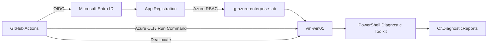
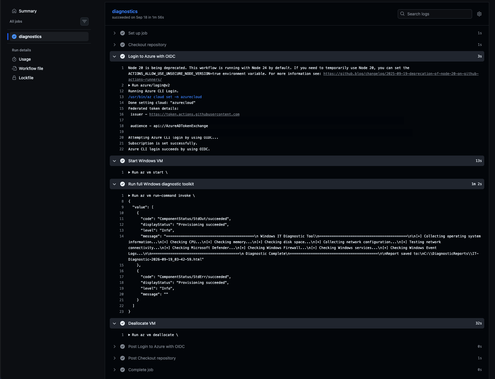
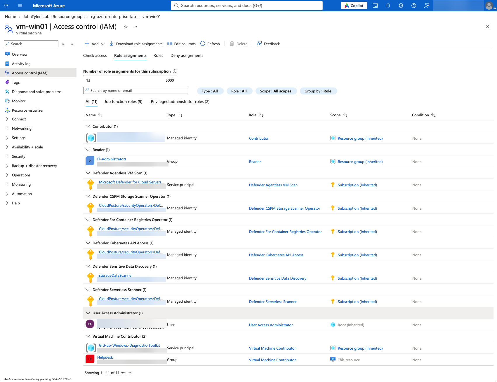

# Azure Windows Diagnostic Automation Workflow

Secure Azure Windows diagnostics triggered from GitHub Actions using **Microsoft Entra ID workload identity federation, OpenID Connect (OIDC), Azure RBAC, Azure VM Run Command, and PowerShell**.

This repository documents the architecture and implementation of an end-to-end automation workflow that starts an Azure Windows Server VM, remotely executes a PowerShell diagnostic toolkit, generates an HTML system-health report, and deallocates the VM after the run.

> **Functional source repository:** [johninfra/windows-it-diagnostic-toolkit](https://github.com/johninfra/windows-it-diagnostic-toolkit)

> **Portfolio lab:** [Lab 27 — Azure Windows Diagnostic Automation](https://github.com/johninfra/it-support-and-cybersecurity-labs/tree/main/Lab-27-Azure-Windows-Diagnostic-Automation-with-GitHub-Actions-OIDC)

## Architecture



## What This Project Demonstrates

- GitHub Actions CI/CD automation
- GitHub-to-Azure OIDC federation
- Microsoft Entra workload identity
- no long-lived Azure client secret
- Azure RBAC scoped to a resource group
- Azure VM lifecycle automation
- Azure VM Run Command
- remote PowerShell execution
- persistent HTML diagnostic reporting
- Windows Server administration
- least-privilege design
- automatic VM deallocation for cost control

## Automation Flow

```text
GitHub repository
      |
      v
GitHub Actions
      |
      | short-lived OIDC token
      v
Microsoft Entra ID
      |
      | federated credential
      v
Azure RBAC
      |
      v
rg-azure-enterprise-lab
      |
      v
vm-win01
      |
      +--> Start VM
      +--> Execute it-diagnostics.ps1
      +--> Save HTML report to C:\DiagnosticReports
      +--> Deallocate VM
```

## Authentication Model

The GitHub workflow authenticates with:

```yaml
permissions:
  id-token: write
  contents: read
```

and:

```yaml
- name: Login to Azure with OIDC
  uses: azure/login@v2
  with:
    client-id: ${{ secrets.AZURE_CLIENT_ID }}
    tenant-id: ${{ secrets.AZURE_TENANT_ID }}
    subscription-id: ${{ secrets.AZURE_SUBSCRIPTION_ID }}
```

The repository does **not** require an `AZURE_CLIENT_SECRET`.

## Azure Authorization

The automation service principal was granted **Virtual Machine Contributor** at the resource-group scope required for the lab.

This prevents the workflow from receiving unnecessary subscription-wide permissions.

## Remote Diagnostic Execution

The workflow executes the PowerShell toolkit with Azure VM Run Command:

```bash
az vm run-command invoke \
  --resource-group rg-azure-enterprise-lab \
  --name vm-win01 \
  --command-id RunPowerShellScript \
  --scripts @it-diagnostics.ps1
```

The toolkit collects Windows system, CPU, memory, disk, network, connectivity, Microsoft Defender, firewall, services, and Windows Event Log information.

## Report Persistence

Reports are written to:

```text
C:\DiagnosticReports\IT-Diagnostic-<timestamp>.html
```

A persistent path is used because Azure Run Command executes scripts from a temporary plugin directory.

## Security Controls

- OIDC federation instead of long-lived Azure credentials
- scoped Azure RBAC
- no passwords or tokens committed to source control
- public IP/account details redacted from portfolio evidence
- automatic VM deallocation
- RDP used only for lab validation; Bastion/JIT/private access would be preferable for production administration

## Execution Evidence

The screenshots below document a successful GitHub Actions run and the corresponding Azure role assignment. Screenshots are redacted to protect account identifiers and unrelated administrative details.

### GitHub Actions — successful end-to-end diagnostics



The successful **diagnostics** job shows Azure CLI login using OIDC, VM startup, execution through Azure VM Run Command, an HTML diagnostic report saved to `C:\\DiagnosticReports`, and VM deallocation. This demonstrates the complete orchestration sequence, not merely a proposed architecture.

### Azure RBAC — workload identity authorization



The Azure IAM view shows the dedicated **GitHub-Windows-Diagnostic-Toolkit** service principal assigned **Virtual Machine Contributor** inherited from the resource group. This supports the documented resource-scoped authorization design. The successful OIDC login above separately demonstrates federated authentication.

> **Screenshot setup:** Create a `screenshots/` folder at the repository root and upload the two redacted PNG files using **exactly** these names: `github-actions-success-redacted.png` and `azure-rbac-full-redacted.png`. The images will display automatically once both files are present. Until then, GitHub will show broken image placeholders.

## Result

The project successfully proved this complete chain:

```text
GitHub Actions -> OIDC -> Microsoft Entra ID -> Azure RBAC
-> Azure Windows VM -> PowerShell diagnostics -> HTML report
```

It demonstrates job-relevant skills across Azure administration, IAM, cloud security, Windows systems administration, automation, and troubleshooting.
